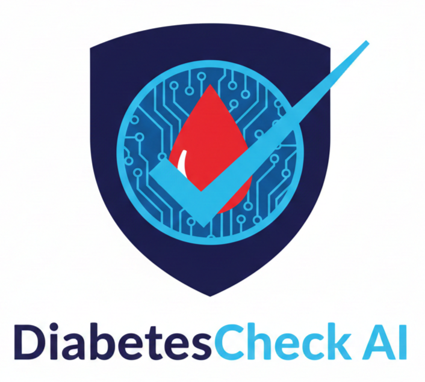
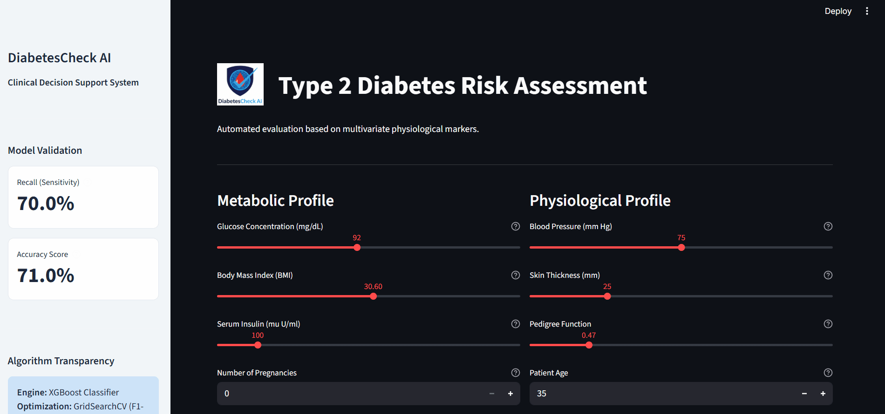

# DiabetesCheck AI: Clinical Decision Support System

<p align="center">
  
</p>

<p align="center">
    <a href="https://diabetescheck-ai.streamlit.app/" target="_blank">
        
    </a>
</p>

<p align="center">
    
    
    
</p>

---

## 🌟 Project Overview

**DiabetesCheck AI** is a professional-grade Clinical Decision Support System (CDSS). 
🔗 **Live Application:** [diabetescheck-ai.streamlit.app](https://diabetescheck-ai.streamlit.app/)

Built using the **Pima Indians Diabetes Dataset**, the application leverages advanced Machine Learning to identify statistical patterns in patient metabolic and physiological markers.

### 📺 Live Demo


---

## 🧠 Technical Excellence

This project focuses on two critical aspects of clinical data science: **Data Integrity** and **Model Sensitivity**.

### 🛠️ Data Pipeline & Preprocessing
* **KNN Imputation:** Instead of simple mean/median filling, we used **K-Nearest Neighbors** to reconstruct missing clinical values (Glucose, Insulin, BMI), preserving multivariate relationships.
* **Class Balancing (SMOTE):** To address the inherent imbalance in medical datasets, we applied **SMOTE** (Synthetic Minority Over-sampling Technique) to ensure the model learns to identify diabetic cases effectively.
* **Feature Scaling:** Robust normalization using `StandardScaler` to ensure optimal convergence for gradient-boosted trees.

### 🔬 The Model: XGBoost
We opted for **XGBoost** for its ability to capture non-linear interactions between physiological markers.
* **Recall (Sensitivity): 70.0%** — Prioritizing the detection of positive cases to minimize false negatives in a screening context.
* **Accuracy: 71.0%** — Maintaining a reliable global precision.

---

## 🎨 User Experience (UX)

The interface is structured into two distinct clinical logical blocks:
1.  **Metabolic Profile:** Focuses on internal biochemistry (Glucose, Insulin, BMI).
2.  **Physiological Profile:** Focuses on physical measurements and genetic factors (Blood Pressure, Age, Pedigree).

### 🔍 Explainable AI (XAI)
The app doesn't just give a score; it provides a **Feature Contribution Chart**. This allows clinicians to see exactly which patient markers deviate the most from a "healthy median" baseline, making the AI's decision transparent.

---

## 🚀 Installation & Local Run

1. **Clone the repository:**
   ```bash
   git clone [https://github.com/Arthur-PREVEL/DiabetesCheck-AI.git](https://github.com/Arthur-PREVEL/DiabetesCheck-AI.git)
   cd DiabetesCheck-AI

2. **Install dependencies:**
    ```bash
    pip install -r requirements.txt

3. **Launch the application:**
    ```bash
    streamlit run app.py

## 📁 Project Structure

     ```
    ├── images/
    │   ├── logo.png          # Brand Identity
    │   ├── favicon.ico       # Browser Icon
    │   └── demo.gif          # Application walkthrough
    ├── app.py                # Streamlit UI & Logic
    ├── Diabetes_Predictor.ipynb # Research & Training Notebook
    ├── model_diabetes.pkl    # Trained XGBoost Model
    ├── scaler.pkl            # Pre-fitted Standard Scaler
    ├── requirements.txt      # Production dependencies
    └── README.md             # Project documentation
     ```

## ⚖️ Disclaimer
This tool is for educational and research purposes only. It is not intended to replace professional medical advice, diagnosis, or treatment. **Always consult a healthcare professional for clinical decisions.**

## 👤 Author
**Arthur PREVEL**
Linkedin : https://www.linkedin.com/in/arthur-pr%C3%A9vel-265229332/